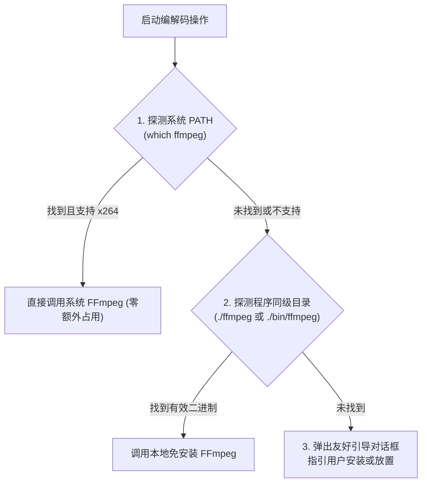

# PixelDrop Linux 桌面端开发与分发规划 (TODO)

> 状态：**【待动工 / PENDING IMPLEMENTATION】**  
> 记录时间：2026-10-25  
> 核心原则：免安装轻量便携包优先、系统级 FFmpeg 智能复用、桌面深度集成、云端 CI/CD 自动打包。

---

## 1. 软件交付与打包形态 (Portable Binary)

* **目标产物**：`PixelDrop-Linux-x64-vX.X.X.tar.gz`（免安装绿色便携压缩包）。
* **便携包文件树规划**：
  ```text
  PixelDrop-Linux-x64/
  ├── pixel_drop                 # Linux 原生 ELF 可执行主程序
  ├── lib/                       # Flutter Linux 引擎依赖动态链接库 (.so)
  ├── data/                      # 字体、资源、图标与元数据 (flutter_assets)
  ├── pixeldrop.desktop          # XDG 标准桌面快捷方式配置模板
  ├── pixeldrop.png              # 256x256 高清点阵矢量应用图标
  ├── install_desktop_entry.sh   # 一键桌面与应用程序菜单集成脚本 (可选运行)
  └── README.txt                 # Linux 快速上手指南与 FFmpeg 配置指引
  ```
* **体积优势**：不强制硬绑上百兆的静态 FFmpeg，整个便携包体积控制在 **~20MB** 左右，轻量秒级下载。

---

## 2. FFmpeg 探测与用户指引策略 (Smart Discovery & Fallback)

针对 Linux 系统的多样性与依赖环境，采用三级智能适配逻辑：



### 引导弹窗与提示文案规划
当探测不到可用 FFmpeg 时，界面阻断并弹出 Material 3 规范的指引对话框：
* **标题**：`未检测到 FFmpeg 视频引擎`
* **内容**：
  > PixelDrop 需要借助 FFmpeg 进行光学点阵视频的压制与解析。  
  > 
  > **推荐方式（一键安装）**：  
  > 打开终端并运行适合您系统的安装命令：  
  > • **Ubuntu / Debian / Deepin**：`sudo apt update && sudo apt install ffmpeg`  
  > • **Fedora / RHEL**：`sudo dnf install ffmpeg`  
  > • **Arch Linux / Manjaro**：`sudo pacman -S ffmpeg`  
  > • **openSUSE**：`sudo zypper install ffmpeg`  
  > 
  > **免 Root 绿色便携方式**：  
  > 自行下载 Linux x64 版 `ffmpeg` 可执行文件，直接放置在 PixelDrop 程序同一目录下即可。
* **操作按钮**：`复制安装命令`、`刷新重新检测`、`了解更多`。

---

## 3. Linux 桌面深度集成体验 (Desktop Integration)

* **XDG 规范与应用菜单集成**：
  * 提供标准 `pixeldrop.desktop`，包含 `Name=PixelDrop`、`GenericName=点阵文件传输工具`、`Categories=Utility;FileTools;`、`MimeType=video/mp4;` 等。
  * 提供一键注册脚本 `install_desktop_entry.sh`：自动将图标与 `.desktop` 写入 `~/.local/share/applications/` 和 `~/.local/share/icons/`，实现系统应用抽屉（GNOME Dash、KDE Launcher）搜索秒开。
* **文件管理器拖拽支持 (Drag & Drop)**：
  * 基于 `desktop_drop` 确保在 X11 与 Wayland 环境下，支持从 GNOME Nautilus、KDE Dolphin、XFCE Thunar 直接拖拽任意文件或 MP4 视频进入应用窗口。
* **还原后高亮定位 (Show in File Manager)**：
  * 在 `StorageHelper.showInExplorer` 中适配 Linux：
    * 优先调用 DBus 原生文件管理器定位接口 `org.freedesktop.FileManager1.ShowItems`；
    * 回退调用 `nautilus --select "$path"` 或 `xdg-open "$parentDir"` 打开所在文件夹。

---

## 4. GitHub Actions CI/CD 云端构建规划 (待动工)

在 `.github/workflows/build.yml` 中待增加的构建任务规划：

```yaml
  build-linux:
    name: Build Linux Portable
    runs-on: ubuntu-latest

    steps:
      - name: Free Disk Space
        run: |
          sudo rm -rf /usr/share/dotnet
          sudo rm -rf /usr/local/lib/android/sdk/ndk*
          sudo rm -rf /opt/ghc
          df -h

      - name: Checkout Code
        uses: actions/checkout@v4

      - name: Install Linux Build Dependencies
        run: |
          sudo apt-get update
          sudo apt-get install -y clang cmake ninja-build pkg-config libgtk-3-dev liblzma-dev

      - name: Set up Flutter
        uses: subosito/flutter-action@v2
        with:
          channel: 'stable'
          cache: true

      - name: Enable Linux Desktop
        run: flutter config --enable-linux-desktop

      - name: Install Dependencies
        run: flutter pub get

      - name: Build Linux Release Bundle
        run: flutter build linux --release

      - name: Package Portable Tar.gz
        run: |
          # 归档打包 bundle 目录并附带 .desktop 与 README
          tar -czvf PixelDrop-Linux-x64-v0.6.0-beta.tar.gz -C build/linux/x64/release/bundle .

      - name: Upload Linux Portable Artifact
        uses: actions/upload-artifact@v4
        with:
          name: PixelDrop-Linux-x64-v0.6.0-beta.tar.gz
          path: PixelDrop-Linux-x64-v0.6.0-beta.tar.gz
```

---

## 5. 待动工检查清单 (Action Checklist)

- [ ] 检查并确保 Linux 下 `desktop_drop` 与 `window_manager` 依赖兼容
- [ ] 在 `lib/services/ffmpeg_runner.dart` 中完善 Linux 平台下的三级探测机制（`which` 探测、同级目录查找）
- [ ] 编写 Linux 未检测到 FFmpeg 时的引导对话框 UI
- [ ] 编写 `assets/linux/pixeldrop.desktop` 与 `install_desktop_entry.sh` 脚本
- [ ] 适配 `StorageHelper.showInExplorer` 的 Linux DBus / xdg-open 实现
- [ ] 在 `.github/workflows/build.yml` 中启用 `build-linux` 自动化构建
